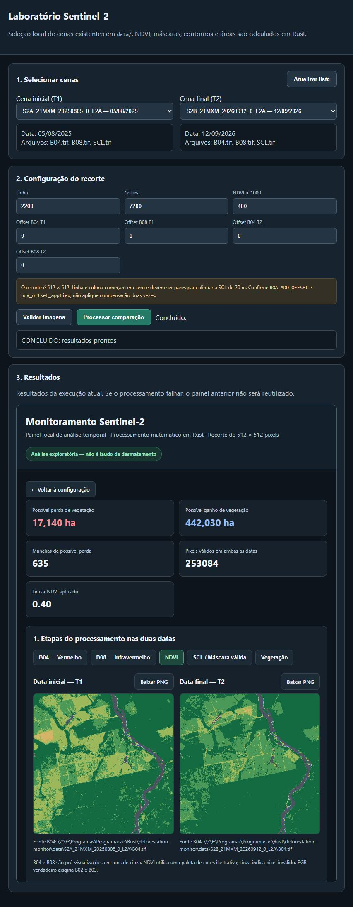

# Monitoramento de cobertura vegetal com Sentinel-2

Projeto acadêmico em Rust para estudar alterações na cobertura vegetal a partir de imagens Sentinel-2 L2A. O programa combina classificação espectral, Geometria Analítica e metadados geográficos para identificar regiões vegetadas, comparar duas datas e calcular áreas de possíveis perdas ou ganhos de cobertura.

O objetivo não é produzir um laudo automático de desmatamento. Uma mudança de classe NDVI pode ter diversas causas — nuvens, sombras, sazonalidade, diferenças atmosféricas ou alterações reais no terreno — e por isso os resultados são apresentados como **possível perda** ou **possível ganho de cobertura vegetal**.

## O que está implementado

- leitura das bandas B04 (vermelho), B08 (infravermelho próximo) e SCL;
- cálculo de NDVI e filtragem dos pixels válidos pela classificação SCL;
- comparação temporal somente onde as duas cenas possuem pixels válidos;
- validação de EPSG, origem, resolução, grade e alinhamento antes da comparação;
- segmentação em componentes conexas por Flood Fill com quatro vizinhos;
- extração de arestas direcionadas e construção de contornos, incluindo buracos;
- cálculo de área pela fórmula do cadarço, usando determinantes e áreas orientadas;
- conferência da área geométrica pela contagem de pixels;
- conversão explícita, em Rust, de pixel para UTM e de UTM para latitude/longitude;
- processamento de um recorte de 512 × 512 pixels;
- processamento integral da área comum das cenas em blocos de até 512 × 512 pixels, com uma máscara temporal global;
- interface web local para selecionar cenas, executar a comparação e inspecionar os resultados;
- exportação de máscaras, imagens, métricas e tabelas CSV.

O processamento global usa os blocos apenas para leitura dos GeoTIFFs. Flood Fill, arestas, contornos e áreas são calculados depois sobre a máscara global, evitando fronteiras artificiais entre blocos.

## Estrutura principal

```text
src/
├── main.rs                  análise de uma única cena
└── bin/
    ├── temporal.rs          comparação entre duas datas
    ├── web.rs               servidor web local
    ├── web_home.html        tela de seleção e execução
    ├── dashboard.html       apresentação dos resultados
    └── search_satellite.rs  consulta ao catálogo Sentinel-2
```

Os cálculos científicos permanecem no código Rust. A interface HTML/CSS/JavaScript é utilizada apenas para entrada, controle, visualização e acesso aos arquivos produzidos.

## Como o código se encaixa

O projeto possui dois fluxos principais:

```text
Navegador
   │
   ▼
web.rs ── chama ──► temporal.rs ──► resultado_temporal/
   │                                      │
   └──────── apresenta dashboard.html ◄───┘

main.rs ──► análise independente de uma única cena
```

- `web.rs` serve a página apenas em `127.0.0.1:3000`, localiza as cenas em `data/`, valida os parâmetros e inicia o binário temporal.
- `temporal.rs` contém a comparação T1 × T2. No modo comum trabalha com um recorte de 512 × 512; com `--full`, percorre toda a área espacial comum em blocos e depois executa a análise geométrica global.
- `main.rs` é o fluxo de uma única data. Ele preserva o experimento original de recorte e também oferece processamento integral com `--full`.
- `dashboard.html` apresenta as imagens e métricas geradas pelo Rust; ele não recalcula NDVI, componentes ou áreas.
- `search_satellite.rs` é um utilitário separado para consultar o catálogo de cenas.

## Compilação rápida

Com Rust e Cargo instalados, abra um terminal na raiz do repositório e execute:

```bash
cargo build --release --bins
```

Esse comando compila todos os binários. No Windows, os executáveis serão gerados em `target/release/` com extensão `.exe`; no Linux, os nomes não possuem essa extensão:

```text
deforestation-monitor  análise de uma cena
temporal               comparação entre duas datas
web                    servidor e interface local
search_satellite       consulta ao catálogo
```

Para conferir a instalação e o código antes de usar imagens reais:

```bash
cargo test
cargo check --all-targets
```

Execute os comandos a partir da raiz do projeto. Os caminhos de `data/`, das saídas e dos arquivos HTML são relativos a esse diretório. Para a interface, o modo recomendado continua sendo `cargo run --bin web`, pois o servidor chama o binário temporal por meio do Cargo.

## Requisitos

- Rust e Cargo compatíveis com a edição 2024;
- imagens Sentinel-2 L2A em GeoTIFF;
- B04 e B08 na mesma grade de 10 m;
- SCL correspondente, normalmente em 20 m;
- cenas temporalmente comparáveis e corretamente alinhadas.

Antes de processar um produto real, confira no metadado `MTD_MSIL2A.xml` os valores de `BOA_ADD_OFFSET` e `QUANTIFICATION_VALUE`. O programa aceita offsets radiométricos, mas não deve ser configurado para aplicá-los novamente quando os TIFFs já estiverem harmonizados.

## Organização dos dados

A interface procura cenas dentro de `data/`. Cada pasta deve representar uma cena e conter os três arquivos abaixo:

```text
data/
├── S2A_21MXM_20250805_0_L2A/
│   ├── B04.tif
│   ├── B08.tif
│   └── SCL.tif
└── S2B_21MXM_20260912_0_L2A/
    ├── B04.tif
    ├── B08.tif
    └── SCL.tif
```

As imagens são arquivos locais e não são versionadas no Git.

## Dados e catálogo

O programa auxiliar `search_satellite` consulta o catálogo público [Earth Search STAC](https://earth-search.aws.element84.com/v1) para localizar produtos Sentinel-2 L2A. Ele possui período, região e tile definidos no código e não baixa automaticamente as bandas.

Ao reproduzir um experimento, registre os identificadores completos dos produtos, as datas de aquisição, o tile MGRS, o CRS, a resolução, os offsets radiométricos e a origem usada para baixar os arquivos. Os GeoTIFFs e os resultados gerados permanecem fora do versionamento por causa do tamanho e da procedência externa dos dados.

## Interface web local

Inicie o servidor com:

```bash
cargo run --bin web
```

Depois acesse:

```text
http://127.0.0.1:3000
```

A interface permite selecionar T1 e T2, definir o recorte e o limiar de NDVI, informar offsets radiométricos e executar a comparação. O servidor é vinculado apenas ao endereço local e não foi projetado para exposição pública.

Os resultados do recorte são gravados em `resultado_temporal/`.

### Interface em funcionamento



*Exemplo de uma execução local com duas datas do tile 21MXM. A captura mostra o recorte selecionado, as métricas calculadas em Rust e as visualizações de NDVI. Os valores pertencem apenas às cenas e aos parâmetros exibidos.*

## Execução pelo terminal

### Comparação temporal de um recorte

```bash
cargo run --bin temporal -- \
  data/CENA_T1/B04.tif data/CENA_T1/B08.tif data/CENA_T1/SCL.tif \
  data/CENA_T2/B04.tif data/CENA_T2/B08.tif data/CENA_T2/SCL.tif \
  2200 7200 400 0 0 0 0
```

Depois dos seis caminhos, os parâmetros são, nesta ordem:

1. linha inicial;
2. coluna inicial;
3. limiar de NDVI multiplicado por 1000;
4. offset B04 de T1;
5. offset B08 de T1;
6. offset B04 de T2;
7. offset B08 de T2.

### Comparação temporal da área comum completa

```bash
cargo run --release --bin temporal -- --full \
  data/CENA_T1/B04.tif data/CENA_T1/B08.tif data/CENA_T1/SCL.tif \
  data/CENA_T2/B04.tif data/CENA_T2/B08.tif data/CENA_T2/SCL.tif
```

Os resultados globais são gravados em `resultado_global_temporal/`. O modo `--release` é recomendado para cenas completas.

Para validar os arquivos e o alinhamento sem executar a análise:

```bash
cargo run --bin temporal -- --validate-only \
  data/CENA_T1/B04.tif data/CENA_T1/B08.tif data/CENA_T1/SCL.tif \
  data/CENA_T2/B04.tif data/CENA_T2/B08.tif data/CENA_T2/SCL.tif
```

### Análise global de uma cena

```bash
cargo run --release -- --full \
  data/CENA/B04.tif data/CENA/B08.tif data/CENA/SCL.tif
```

## Método resumido

Para cada pixel radiometricamente válido, o NDVI é calculado por:

```text
NDVI = (B08 - B04) / (B08 + B04)
```

A máscara SCL é usada para excluir classes que não devem participar da comparação. Os pixels válidos são classificados em cinco estados temporais:

- inválido em pelo menos uma data;
- vegetação estável;
- não vegetado estável;
- possível perda de cobertura vegetal;
- possível ganho de cobertura vegetal.

As manchas de possível perda são identificadas com conectividade de quatro vizinhos. Em seguida, suas fronteiras são representadas por segmentos orientados. A área de cada contorno é calculada pela fórmula do cadarço:

```text
A = 1/2 · Σ (xᵢyᵢ₊₁ - xᵢ₊₁yᵢ)
```

O sinal da área orientada permite descontar buracos. A soma final é comparada à quantidade de pixels da máscara, fornecendo uma verificação independente da construção geométrica.

## Testes e verificação

Execute:

```bash
cargo test
cargo check --all-targets
```

Os testes cobrem, entre outros casos:

- componentes isoladas e regiões em formato de L;
- contatos apenas diagonais;
- polígonos com buracos;
- múltiplos contornos por componente;
- identidade entre T1 e T2, sem perdas ou ganhos;
- dimensões menores que um bloco e não múltiplas de 512;
- manchas atravessando duas ou quatro janelas;
- equivalência dos resultados para diferentes tamanhos de bloco sintéticos;
- equivalência entre área por determinantes e área por contagem de pixels.

## Limitações

- Os resultados indicam alteração espectral, não desmatamento confirmado.
- A qualidade depende da seleção das cenas, da máscara SCL e dos parâmetros radiométricos.
- O programa valida o alinhamento, mas não realiza reprojeção silenciosa.
- O processamento global requer memória proporcional ao número total de pixels, principalmente para a máscara, os rótulos, a fila do Flood Fill e os contornos.
- A busca no catálogo possui região, período e tile definidos no código e funciona como programa de apoio, não como downloader completo.
- Os resultados devem ser revisados por uma pessoa com conhecimento da região e dos produtos Sentinel-2.

## Uso de inteligência artificial

Este projeto foi elaborado com assistência de inteligência artificial no aplicativo Codex em **30 de outubro de 2026**, incluindo apoio na redação, na programação em Rust, na integração com a API de catálogo, na interface web e na documentação. A identificação exata do modelo utilizado não foi registrada no material do projeto.

As imagens de satélite foram obtidas das fontes de dados indicadas pelo projeto e **não foram geradas por inteligência artificial**. As máscaras, os contornos, os gráficos e as métricas são resultados do processamento descrito neste repositório.

Durante a elaboração assistida, os programas de apoio foram executados, valores de referência foram conferidos e os binários e testes disponíveis foram compilados. Essas verificações não equivalem a uma revisão humana independente. Os responsáveis pelo trabalho devem revisar o código, registrar o próprio uso de ferramentas de IA e assumir responsabilidade pelos métodos, resultados e conclusões apresentados.

## Licença e uso acadêmico

O repositório foi desenvolvido como estudo de Geometria Analítica aplicada a sensoriamento remoto. Antes de reutilizar o código ou os resultados em publicação, avaliação ou tomada de decisão, verifique a licença dos dados de origem, documente os produtos empregados e realize validação independente.
